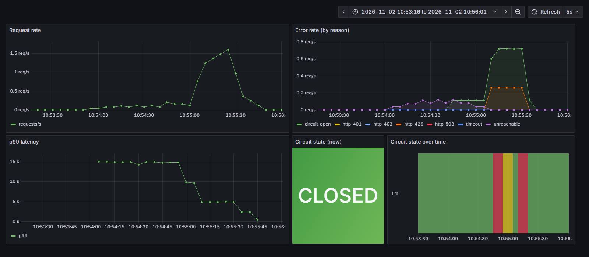
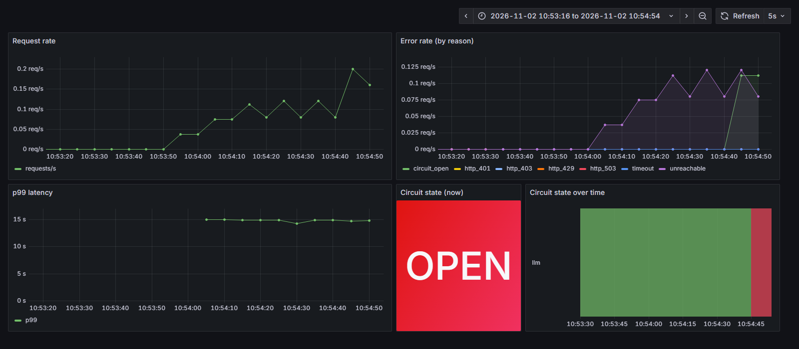
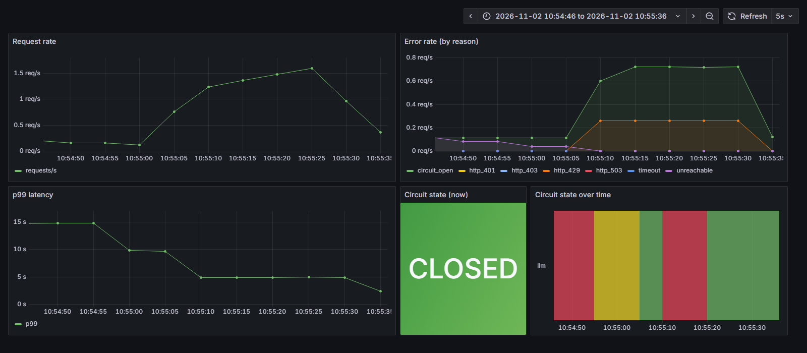
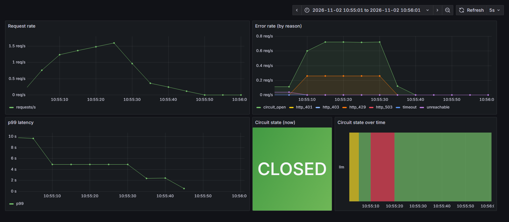

# Lab 3 – Task B: Chaos Engineering Tests

Service: FastAPI on `:8080`, `POST /generate` → Ollama `llama3.2:1b`.
Resilience defaults (all overridable by env var, see [src/config.py](../src/config.py)):

| Setting | Env var | Default |
|---|---|---|
| Retry attempts | `RETRY_MAX_ATTEMPTS` | 3 |
| Initial backoff | `RETRY_INITIAL_DELAY` | 1 s |
| Backoff multiplier | `RETRY_MULTIPLIER` | 2 (1 s → 2 s → 4 s) |
| Breaker threshold | `CB_FAILURE_THRESHOLD` / `CB_WINDOW_SIZE` | 5 failures in last 10 calls |
| Breaker open time | `CB_OPEN_WAIT` | 10 s |
| LLM call timeout | `LLM_TIMEOUT` | 30 s |
| LLM endpoint | `LLM_API_URL` | `http://localhost:11434` |

Retries happen on 429, 503 and connection failures. 401/403 are returned at once (retrying a bad key
cannot help). A timeout returns 504. When the circuit is OPEN the API is not called and the service returns
`503 {"status": "circuit_open", "retry_after": <s>, "message": "LLM service temporarily unavailable"}`.

The **expected behaviour of each test is documented in the module docstring of
[src/chaos.py](../src/chaos.py)**. The results below come from one run of `python -m src.chaos all`
(full output: [logs/chaos.log](../logs/chaos.log); service log: [logs/service.log](../logs/service.log)).

## Setup (common to all tests)

```powershell
ollama serve                                         # llama3.2:1b already pulled
docker compose up -d                                 # Prometheus :9090 (scrapes :8080/metrics every 5s), Grafana :3000
$env:LLM_API_URL="http://localhost:9999"             # the "LLM" endpoint used for every chaos test
poetry run python -m src.app                         # service on :8080
poetry run python -m src.chaos all                   # or 1 / 2 / 3 individually
```

The service always points at `localhost:9999`. The chaos script breaks and restores the LLM by
stopping and starting [src/rate_limit_proxy.py](../src/rate_limit_proxy.py) on that port, so the
service never restarts and the breaker keeps its state across tests:

- **Nothing on :9999.** The endpoint does not exist (Test 1).
- **Proxy on :9999 with `MAX_CONCURRENT=2`.** The proxy forwards to Ollama but returns 429 to anything
  above 2 requests in flight (Test 2). Ollama itself never returns 429; it only queues requests.
- **Proxy on :9999 with no effective cap.** The LLM is restored (Test 3).

Grafana dashboard "LLM Service" panels: request rate, error rate by reason, p99 latency, circuit state
(0 = CLOSED/green, 1 = OPEN/red, 2 = HALF_OPEN/yellow).



---

## Test 1 – Simulated LLM downtime

**Steps to reproduce**
1. Start the service with `LLM_API_URL=http://localhost:9999` and make sure nothing is listening on 9999.
2. `poetry run python -m src.chaos 1`. This sends 8 sequential `POST /generate` requests.

**Expected** (see `src/chaos.py`): each request makes 3 attempts with 1 s and 2 s backoff, then returns
503 "LLM unreachable". The 5th failed request opens the circuit. Requests after that get
`503 circuit_open` immediately, without calling the LLM.

**Observed**

```
req 1      HTTP 503 in   10029ms  LLM unreachable: All connection attempts failed circuit=CLOSED
...
req 5      HTTP 503 in   10001ms  LLM unreachable: All connection attempts failed circuit=OPEN
req 6      HTTP 503 in      10ms  circuit_open                                  circuit=OPEN
req 7      HTTP 503 in      15ms  circuit_open                                  circuit=OPEN
req 8      HTTP 503 in      12ms  circuit_open                                  circuit=OPEN
```

Service log (5th request, then fail-fast):

```
10:54:28.654 INFO Calling LLM at http://localhost:9999
10:54:30.976 WARNING Attempt 1/3 failed (ConnectError: All connection attempts failed) - retrying in 1.0s
10:54:31.996 INFO Calling LLM at http://localhost:9999
10:54:34.315 WARNING Attempt 2/3 failed (ConnectError: All connection attempts failed) - retrying in 2.0s
10:54:36.322 INFO Calling LLM at http://localhost:9999
10:54:38.633 ERROR Giving up after 3 attempts (ConnectError: All connection attempts failed)
10:54:38.639 INFO Circuit 'llm' CLOSED - failure recorded (5/5 failures in last 5 calls)
10:54:38.640 WARNING Circuit 'llm' STATE CHANGE: CLOSED -> OPEN (5 failures in last 5 calls)
10:54:38.670 INFO Circuit 'llm' OPEN - rejecting call (half-open in 10.0s)
10:54:38.671 WARNING FALLBACK: circuit OPEN, returning 503 circuit_open (retry_after=10s) for prompt 'Reply with one short sentence.'
```

- (a) Retries with backoff are visible: there is a 1 s gap after attempt 1 and a 2 s gap after
  attempt 2.
- (b) The circuit opened on the 5th failure.
- (c) Requests 6–8 were answered in 10–15 ms. No "Calling LLM" line was logged for them, so the API was
  not called.

Note: a failed request took about 10 s rather than about 3 s. On Windows, a refused connection to
`localhost` takes about 1 s per address before the error comes back, and httpx tries both `::1` and
`127.0.0.1`. Each attempt therefore took about 2.3 s, plus 1 s and 2 s of backoff.

**Grafana:** the `unreachable` error rate rises, then `circuit_open` appears. p99 latency sits at the
top of the 10–15 s histogram bucket. The circuit-state lane turns red when the circuit opens.



---

## Test 2 – Rate limiting

**Steps to reproduce**
1. Start the proxy on :9999 with `MAX_CONCURRENT=2`
   (`$env:MAX_CONCURRENT=2; poetry run uvicorn src.rate_limit_proxy:app --port 9999`; `src.chaos 2` does this
   for you).
2. Wait until the circuit is CLOSED.
3. Send 15 concurrent requests, then another 15 straight away.

**Expected** (see `src/chaos.py`): most requests in the first burst get 429 and retry with backoff, and
some of them succeed on a retry. Requests that still get 429 on attempt 3 return 429 and count as breaker
failures. Five of them open the circuit, and the second burst fails fast with `503 circuit_open`. Grafana
shows a spike in the error rate.

**Observed**

```
--- burst 1: 15 concurrent requests
b1-01      HTTP 200 in     308ms  "I'm here to provide information ..."  circuit=CLOSED
b1-05      HTTP 200 in    1856ms  "I'm ready to help with your ..."      circuit=CLOSED    <- succeeded on a retry
b1-12      HTTP 429 in    3793ms  LLM returned 429                       circuit=CLOSED    <- 3 attempts, all 429
b1-09      HTTP 429 in    3861ms  LLM returned 429                       circuit=OPEN
b1-10      HTTP 200 in    4134ms  "I'm ready to help."                   circuit=OPEN
burst 1 result: {200: 8, 429: 7}  circuit=OPEN
--- burst 2: 15 concurrent requests
burst 2 result: {503: 15}  circuit=OPEN
```

Service log:

```
10:55:00.110 WARNING Attempt 1/3 failed (HTTP 429) - retrying in 1.0s      (x11)
10:55:01.206 WARNING Attempt 2/3 failed (HTTP 429) - retrying in 2.0s      (x9)
10:55:03.275 ERROR Giving up after 3 attempts (HTTP 429)
10:55:03.275 INFO Circuit 'llm' CLOSED - failure recorded (1/5 failures in last 7 calls)
...
10:55:03.335 INFO Circuit 'llm' CLOSED - failure recorded (5/5 failures in last 10 calls)
10:55:03.335 WARNING Circuit 'llm' STATE CHANGE: CLOSED -> OPEN (5 failures in last 10 calls)
10:55:03.669 WARNING FALLBACK: circuit OPEN, returning 503 circuit_open (retry_after=10s) ...   (x15)
```

- (a) 11 of 15 requests got 429 on their first attempt and were retried after 1 s, then 2 s. Four of
  them got a slot on a retry and returned 200.
- (b) Seven requests used up all 3 attempts. The 5th of those opened the circuit, and the whole second
  burst was rejected without reaching the proxy.
- (c) Grafana shows the request-rate spike, an `http_429` error band, and a larger `circuit_open` spike.
  Captured at the failure peak:



---

## Test 3 – Recovery

**Steps to reproduce**
1. Run this straight after Test 2, while the circuit is still OPEN.
2. Restart the proxy on :9999 with no concurrency cap. This fixes the endpoint and stops the flood.
3. Send one request every 2 s while the circuit is OPEN. Once it goes HALF_OPEN, send a trial request,
   then 5 more requests (`src.chaos 3`).

**Expected** (see `src/chaos.py`): requests still fail fast while the circuit is OPEN. After 10 s the
circuit goes HALF_OPEN and exactly one trial request is let through. The trial succeeds, so the circuit
goes back to CLOSED and later requests succeed normally.

**Observed**

```
circuit at start: OPEN
while OPEN HTTP 503 in      13ms  circuit_open           circuit=OPEN
while OPEN HTTP 503 in      13ms  circuit_open           circuit=OPEN
while OPEN HTTP 503 in      15ms  circuit_open           circuit=OPEN
circuit is now HALF_OPEN - next request is the trial
trial      HTTP 200 in    1616ms  "I'm ready to help."   circuit=CLOSED
after 1    HTTP 200 in     245ms  ...                    circuit=CLOSED
...
after 5    HTTP 200 in     262ms  ...                    circuit=CLOSED
```

Service log:

```
10:55:13.975 WARNING Circuit 'llm' STATE CHANGE: OPEN -> HALF_OPEN (10s wait elapsed)
10:55:13.998 INFO Circuit 'llm' HALF_OPEN - letting trial call through
10:55:15.600 WARNING Circuit 'llm' STATE CHANGE: HALF_OPEN -> CLOSED (trial call succeeded)
```

- (a) The trial request succeeded.
- (b) The circuit went from HALF_OPEN to CLOSED.
- (c) All later requests returned 200 in about 0.2 s.

The OPEN → HALF_OPEN change is evaluated whenever the state is read, either by a request or by the
Prometheus scrape every 5 s. So it is logged on the first read after the 10 s wait, which can be up to
about 5 s late when there is no traffic.

**Grafana:** the circuit-state lane goes red, then yellow, then green. The error rate drops to 0, and p99
latency falls back to under a second.



---

## Other error paths (checked against the mock LLM, `src/mock_llm.py`)

| Case | Result |
|---|---|
| Bad API key (`/auth` mock) | `401 {"error": "LLM returned 401"}` in 0.12 s, no retries, breaker not tripped |
| `LLM_TIMEOUT=0.02` against a slow LLM | `504 {"error": "LLM call timed out"}`, counted as a breaker failure |
